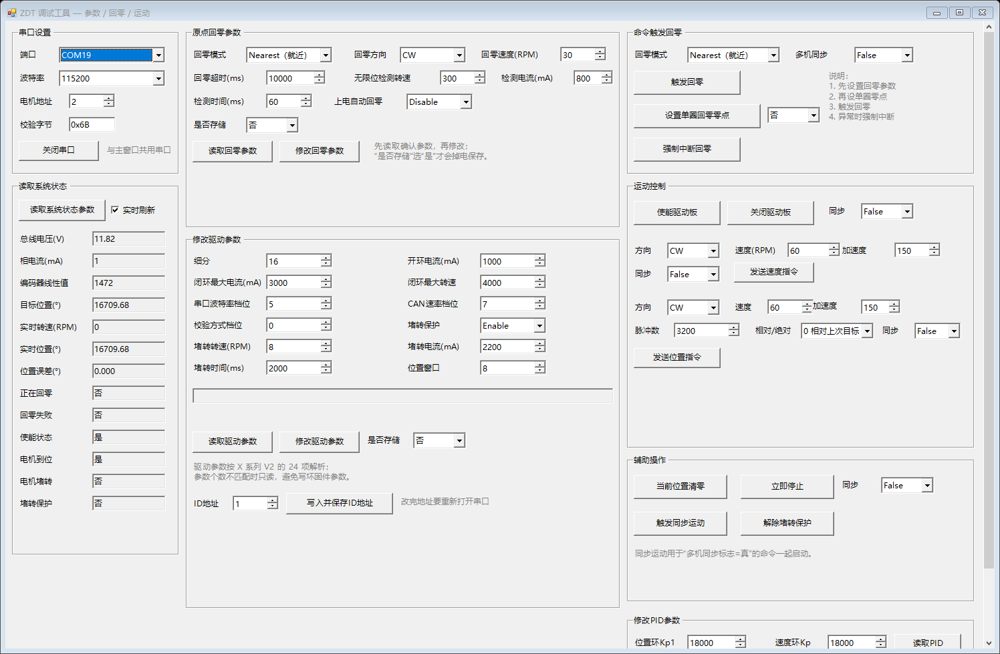
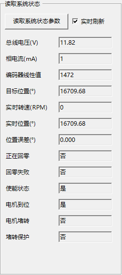

# ZdtMotorGui

基于 **C# WinForms** 的 ZDT 闭环步进电机串口调试上位机，用于通过 USB 转 485 / TTL 调试 ZDT 步进驱动器：串口通信、回零、点动/定位、参数读写、系统状态实时刷新。


## 界面



> 界面示意：系统状态数值来自 COM19 / 地址 2 的实测示例，实际会随电机状态变化。

系统状态支持 500ms 实时刷新；串口关闭时会提示，连续无应答会自动暂停：



## 功能

- **串口设置**：端口、波特率、电机地址、校验字节（默认 `0x6B`）；与主窗口共用串口。
- **系统状态**：`0x43` 一次读取母线电压、相电流、编码器、目标/实时位置、转速、位置误差、回零/电机状态；兼容 Emm 31 字节与 X 37 字节两种 `0x43` 布局；500ms 实时刷新。
- **回零**：`0x22` 读取 / `0x4C 0xAE` 写入回零参数；`0x9A` 触发回零；`0x9C 0x48` 中止；`0x93 0x88` 设置单圈零点。
- **运动控制**：`0xF3` 使能/失能、`0xF6` 速度模式、`0xFD` 位置模式、`0xFE` 立即停止、`0xFF 0x66` 同步启动、`0x0E 0x52` 解除堵转/过流保护。
- **驱动参数**：`0x42 0x6C` 读取原始参数帧、`0x48 0xD1` 写入；参数项与 24 项布局不匹配时只读显示，避免误写。
- **PID**：`0x21` 读取、`0x4A 0xC3` 写入，按实际返回长度解析。
- **双轴主界面**：`MainForm` 提供旋转轴/推动轴两个面板，支持点动、步进、软限位、回零。当前 `Program.cs` 入口是单轴调试工具；需要双轴界面时把 `Application.Run(new ZdtToolForm())` 改为 `new MainForm()`。
- **实时刷新保护**：串口未开提示“请先打开串口”；连续 3 次无应答自动暂停并提示检查地址/串口。

## 快速开始

环境：Visual Studio 2022 + .NET Framework 4.8。

1. 打开 `ZdtMotorGui.sln`，按 F5。
2. 选择串口（如 `COM19`）、波特率 `115200`、电机地址（如 `2`）、校验字节 `0x6B`。
3. 点“打开串口”，系统状态开始 500ms 实时刷新。
4. 在“回零 / 运动控制 / 驱动参数 / PID”页按需操作。

> 第一次接实物建议顺序：读状态 → 使能 → 低速小角度 → 回零；先空载、低速、低电流测试。

## 设备与协议

本仓库按 ZDT X42S 串口自由协议实现，默认 **115200、8 数据位、无校验、1 停止位**，校验字节默认 **0x6B**。

- 实测驱动器能力、`0x43` 的 31/37 字节布局、支持/不支持的命令：[设备实测与协议说明](docs/设备实测与协议说明.md)
- 完整串口协议、命令表、参数和接线说明：
  - [ZDT X42S 串口协议 / 上位机库使用手册（PDF）](docs/Zdt.X42S使用手册.pdf)
  - [ZDT X42S 串口协议 / 上位机库使用手册（HTML）](docs/Zdt.X42S使用手册.html)

## 目录结构

```
ZdtMotorGui.sln
ZdtMotorGui/
  Program.cs             程序入口（当前启动调试工具）
  MainForm.cs            双轴主界面
  AxisPanel.cs           单轴面板：点动/步进/软限位/回零
  ZdtToolForm.cs         调试工具：参数/回零/状态/运动/PID
  Zdt.cs                 串口协议：组帧、校验、应答
  app.manifest
docs/
  Zdt.X42S使用手册.pdf
  Zdt.X42S使用手册.html
  设备实测与协议说明.md
  images/
    ui.png
    system-status.png
```

## 注意事项

- 接线、拔插电机线/通讯线前先断电；RS485 注意 A/B、共地和终端电阻，长距离/高波特率建议加 120Ω 终端电阻。
- 调试先空载、低速、小电流；确认急停/断电方式，云台俯仰轴失能前确认不会因重力下坠。
- 本工具是个人调试上位机，未做工业级异常恢复；请勿直接用于无人值守设备。
- 实测这台驱动器不支持 `0x3C/0x1A/0x3D/0x26/0x39/0x41`，相关界面显示“-- / 不支持”属正常；系统状态读 `0x43`（31 字节 Emm 布局）。
- 这台驱动器的 `0x42` 驱动参数为 21 项布局；工具按 24 项布局解析不匹配时只显示原始帧，避免误写。
- 手册版权归 ZDT 所有，仓库内仅作学习/调试参考。

## License

MIT License，见 [LICENSE.txt](LICENSE.txt)。
